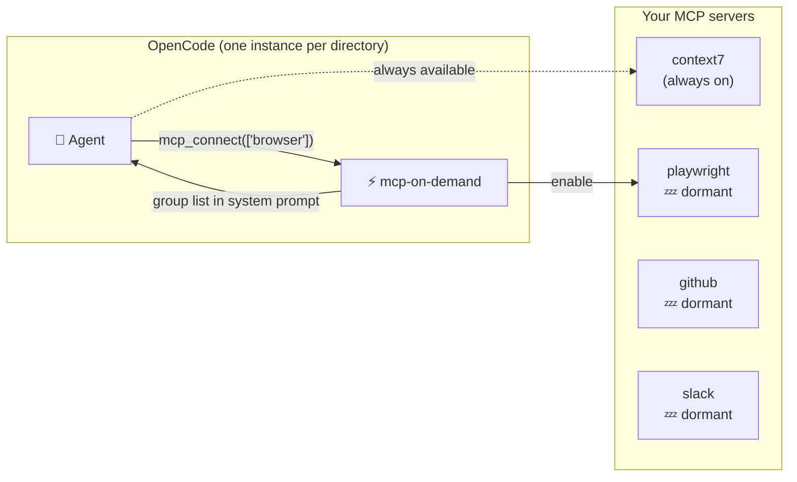
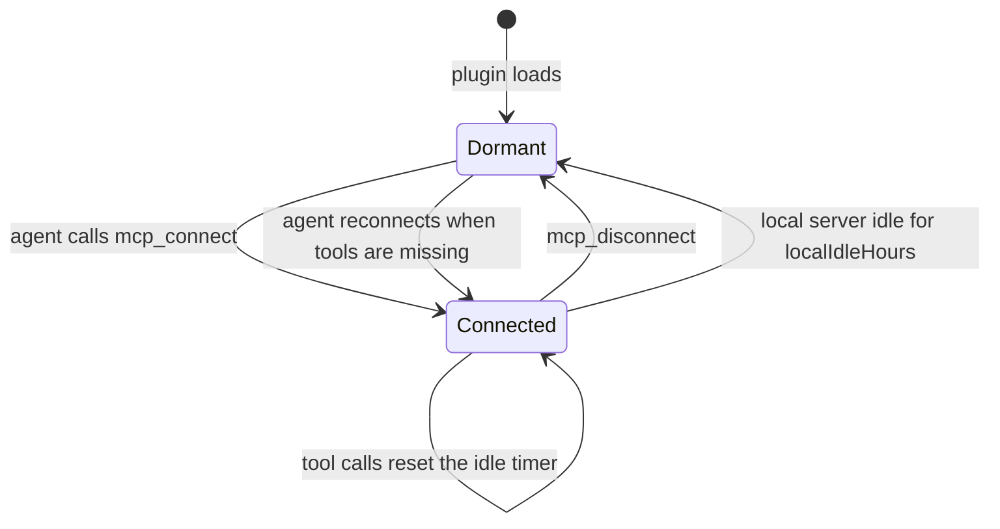

<p align="center">
  
</p>

<p align="center">
  <a href="#quick-start">Quick start</a> ·
  <a href="#how-it-works">How it works</a> ·
  <a href="#generate-your-settings">Generate your settings</a> ·
  <a href="#configuration">Configuration</a> ·
  <a href="#faq">FAQ</a>
</p>

An [OpenCode](https://opencode.ai) plugin that keeps your MCP servers **off until an agent actually needs them**.

By default OpenCode connects every configured MCP server for every directory you have a session in. With a handful of local servers and a few open projects that quickly becomes dozens of `node`/`npx` processes and gigabytes of RAM, and every server's instructions get added to every prompt, whether the task needs them or not.

`mcp-on-demand` fixes both:

| | Without | With mcp-on-demand |
|---|---|---|
| Local MCP processes | one set per open directory, always running | only the servers a session asked for |
| Prompt overhead | every server's instructions, every turn | a short list of groups, plus instructions for connected servers only |
| Using a server | always there | agent calls `mcp_connect("browser")`, tools appear on its next step |
| Forgotten servers | run until you quit | idle local servers stop after 6 hours |

Real-world example from the author's machine: **~70 local MCP processes (several GB) down to 0** at idle, with 25 servers still one call away.

## Quick start

**1. Install** (macOS / Linux):

```sh
curl -fsSL https://raw.githubusercontent.com/chrismaree/open-code-mcp-on-demand/master/install.sh | sh
```

This copies one file, `mcp-on-demand.ts`, into `~/.config/opencode/plugins/` and creates a starter `~/.config/opencode/mcp-on-demand.json`. OpenCode loads plugins from that folder automatically. No `opencode.json` changes are needed.

**2. Restart OpenCode** (or open a new session).

That's it. Every MCP server is now dormant, and the agent sees them listed as "Ungrouped servers" it can connect by name.

**3. Recommended: group your servers** so the agent knows *when* to use each one. Paste the prompt from [Generate your settings](#generate-your-settings) into an OpenCode session.

**4. Check it:** ask the agent *"run mcp_status"*.

<details>
<summary>Manual install</summary>

```sh
mkdir -p ~/.config/opencode/plugins
curl -fsSL https://raw.githubusercontent.com/chrismaree/open-code-mcp-on-demand/master/mcp-on-demand.ts \
  -o ~/.config/opencode/plugins/mcp-on-demand.ts
```

Or clone this repo and symlink the file:

```sh
git clone https://github.com/chrismaree/open-code-mcp-on-demand.git
ln -s "$PWD/open-code-mcp-on-demand/mcp-on-demand.ts" ~/.config/opencode/plugins/mcp-on-demand.ts
```

OpenCode watches the symlink, not its target, so after editing the repo copy reload with `touch -h ~/.config/opencode/plugins/mcp-on-demand.ts`.

</details>

## How it works



1. **At startup** the plugin marks every configured MCP server as disabled, except those in `alwaysOn` (and any groups you auto-connect for that directory).
2. **The agent sees a short catalog** of your groups in its system prompt, plus three tools: `mcp_connect`, `mcp_disconnect` and `mcp_status`.
3. **When a task needs a server**, the agent calls `mcp_connect` with a group or server name. OpenCode connects it and the tools appear from the agent's next step.
4. **Idle local servers stop.** Local (stdio) servers with no tool calls for `localIdleHours` and nothing in flight are turned off again. Remote servers stay connected; they cost no memory.
5. **Recovery is automatic.** If tools are missing (idle stop, restart), the agent just calls `mcp_connect` again. It's safe to repeat.

### A server's lifecycle



### Under the hood

It's a single file built only on OpenCode's native V2 plugin API: no proxy, gateway or extra process.

| Need | OpenCode plugin API |
|---|---|
| Turn servers on and off | `ctx.mcp.transform` + `ctx.mcp.reload()` |
| Agent-facing tools | `ctx.tool.transform` |
| Group catalog in the prompt | `ctx.session.hook("context")` |
| Usage tracking for idle stop (including Code Mode) | `ctx.tool.hook("execute.before" / "execute.after")` |
| Per-directory state | `ctx.location.directory` |

## Generate your settings

Your settings depend on which MCP servers *you* have, so there's nothing to copy. Let your agent write them. Paste this into an OpenCode session:

> Read my OpenCode MCP configuration (`~/.config/opencode/opencode.json`, any project `opencode.json` / `.opencode/opencode.json`) and run `mcp_status` to see every MCP server I have. Then write `~/.config/opencode/mcp-on-demand.json` following the schema of https://github.com/chrismaree/open-code-mcp-on-demand/blob/master/mcp-on-demand.example.json:
>
> - Put a server in `alwaysOn` only if it is cheap and useful in almost every session (for example docs lookup or memory). Keep this list short.
> - Group the rest by **task**: when would someone need it, not who makes it. Aim for 4–12 groups and keep servers that are usually used together in one group.
> - Give each group one specific sentence saying what it gives access to and when to use it. The agent reads these descriptions to decide what to connect.
> - Use the exact server names from my config.
> - Never copy URLs, headers, API keys, tokens or any other secrets into this file.
>
> Show me the result before saving it. Afterwards, apply it with `touch ~/.config/opencode/plugins/mcp-on-demand.ts`.

## Configuration

`~/.config/opencode/mcp-on-demand.json` (see [`mcp-on-demand.example.json`](mcp-on-demand.example.json)):

```jsonc
{
  "enabled": true,                 // false = plugin does nothing, servers keep their configured state
  "alwaysOn": ["context7"],        // never made dormant
  "localIdleHours": 6,             // stop idle local servers after this long
  "groups": {
    "browser": {
      "description": "Browser automation: open pages, click, fill forms, take screenshots.",
      "servers": ["playwright", "chrome-devtools"]
    }
  },
  "autoConnect": [                 // connect groups automatically in matching directories
    { "directory": "~/work/my-web-app*", "groups": ["browser"] }
  ]
}
```

| Key | Default | Notes |
|---|---|---|
| `enabled` | `true` | Set `false` to switch the plugin off without uninstalling. |
| `alwaysOn` | `[]` | Server names that are never touched. |
| `localIdleHours` | `6` | Idle timeout for local (stdio) servers. Remote servers are never stopped by the timer. |
| `localIdleMinutes` | — | Overrides `localIdleHours`. Handy for testing the idle stop. |
| `groups` | `{}` | Group name → `{ description, servers }`. Servers not in a group are still dormant and connectable by name. |
| `autoConnect` | `[]` | `directory` matches the directory and its subdirectories; `*` matches within one path segment. |

**Applying changes:** run `touch ~/.config/opencode/plugins/mcp-on-demand.ts`. The plugin reloads; editing only the JSON is not picked up. Reloading resets on-demand connections, and agents reconnect as needed.

**Alternatives:** settings can also be passed as plugin `options` in `opencode.json` (they override the file), and `OPENCODE_MCP_ON_DEMAND_CONFIG` points at a different settings path.

### Adding a new MCP server

Add it to OpenCode as usual (`opencode mcp add …`). It starts **dormant automatically** and is listed to the agent as ungrouped. Optionally add it to a group with a description, or to `alwaysOn`, then touch the plugin file.

## Agent tools

| Tool | What it does |
|---|---|
| `mcp_connect({ targets })` | Turns on groups or servers for the current directory and waits until they're connected. Idempotent. |
| `mcp_disconnect({ targets })` | Turns them back off. |
| `mcp_status()` | Lists groups and every server's state: always-on, on-demand (on) or dormant. |

## FAQ

**What happens if the plugin breaks?**
It only changes server state at runtime and never edits `opencode.json`. If it fails to load, every server keeps its configured state, so you're back to stock behaviour instead of missing tools.

**Why does a tool appear one step late?**
OpenCode snapshots the tool list per model request, so tools from a newly connected server appear on the agent's next step. The `mcp_connect` result tells the agent this.

**Do connections affect other sessions?**
Yes, within the same directory. OpenCode connects MCP servers per directory, so all sessions in that directory share them. A disconnect or idle stop in one affects the others, which simply reconnect.

**Is state lost when a local server stops?**
Yes. A restarted server starts fresh (for example, an open browser page is gone). That's why the idle timeout is long.

**Where are the logs?**
`~/.local/share/opencode/log/mcp-on-demand.log`: loads, connects, tool use and idle stops.

**Uninstall?**
`rm ~/.config/opencode/plugins/mcp-on-demand.ts` (and optionally `~/.config/opencode/mcp-on-demand.json`), then restart OpenCode.

## Compatibility

Built for the **OpenCode V2 plugin API**, tested on OpenCode v2.1.2. Related upstream discussions: [lazy MCP loading (#8277)](https://github.com/anomalyco/opencode/issues/8277) and [duplicate MCP processes per session (#29939)](https://github.com/anomalyco/opencode/issues/29939). If OpenCode ships native lazy loading, this plugin may become unnecessary.

## License

[MIT](LICENSE)
